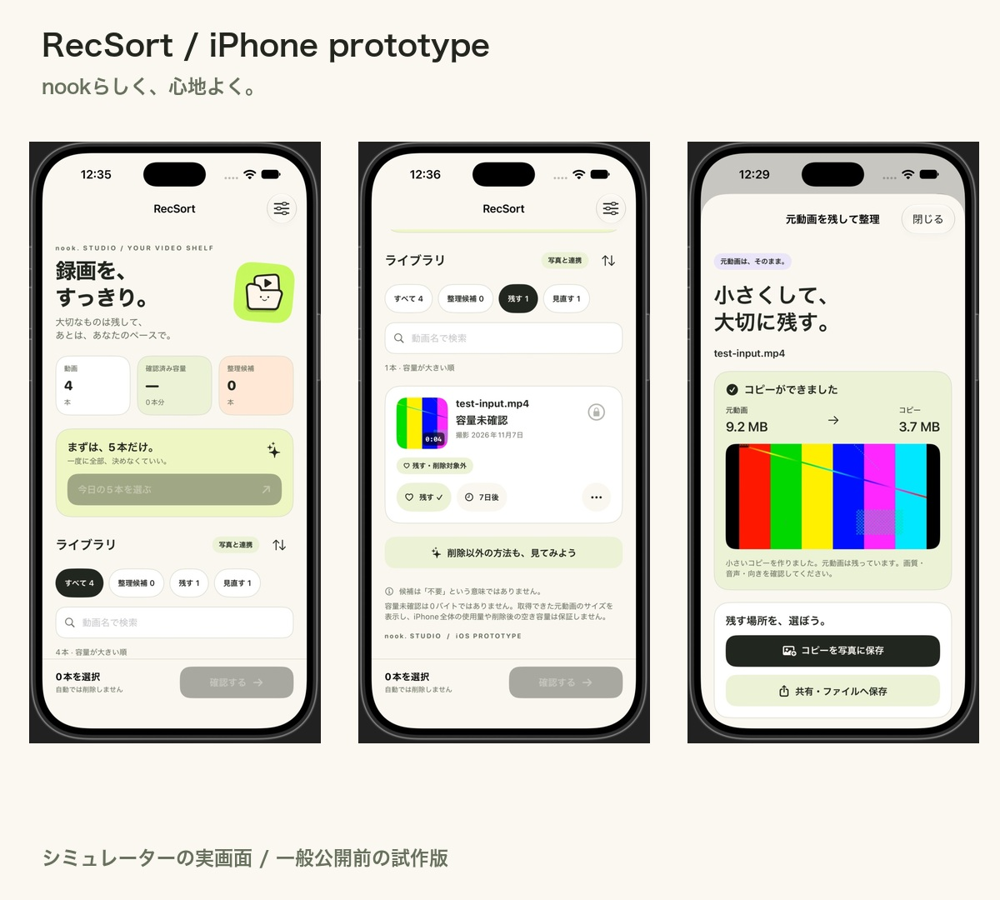

# RecSort

**録画を、すっきり。** 大切な動画を守りながら、理由を見て整理を決めるプロトタイプです。

## 発表スライド

### [説明用スライドを開く（PDF）](docs/RecSort-slides.pdf)

**本編は1〜6ページ。7〜10ページは質問用です。** 11月9日の当日改訂版を掲載しています。

[PDFをダウンロードする](https://github.com/nookstudiojp/recsort/raw/refs/heads/main/docs/RecSort-slides.pdf) — GitHubのPDF表示が使いにくい場合は、保存してPDFアプリで開いてください。

## 実演する

### [RecSort公開サイトを開く](https://recsort-studio.alikemerit.chatgpt.site/)

「サンプルでお試し」を押すと、実動画を用意せず操作できます。架空の動画の容量・候補理由を見て、「残す」の保護と最後の確認を試せます。

**発表は本人の説明と実演で進行します。** AI音声の紹介動画は記録・参考用です。

## 紹介動画（記録・参考用）

### [紹介動画を保存する（MP4・約3分48秒）](https://github.com/nookstudiojp/recsort/raw/refs/heads/main/docs/media/RecSort-introduction.mp4)

公開Web版・開発中の追加機能・iPhone試作を紹介しています。1080p、約9MB。声はVOICEVOX:四国めたん、BGMはNook Studioオリジナルです。

[動画の構成と台本](docs/RecSort-presentation-script.md)

## 必要な資料を探す

| 確認したいこと | 開く資料 |
| --- | --- |
| 誰の悩みに、どの機能が役立つと考えたか | [顧客像・悩みの仮説と確認計画](docs/CUSTOMER-HYPOTHESES.md) |
| 質疑応答 | [最新FAQ](docs/FAQ.md) |
| 機能・技術・保存方法の詳しい説明 | [プロジェクト詳細](docs/PROJECT-DETAILS.md) |
| 動作を確認した範囲と、残る課題 | [検証記録](docs/VERIFICATION.md) |

顧客像と効果は仮説です。体系的な顧客ヒアリングは未実施で、いただいた質問・感想と区別しています。

## iPhone版のスクリーンショット

写真ライブラリの動画を一覧にし、「残す」で保護したり、元動画を残した圧縮コピーを作ったりできます。**画像はiOS Simulator上の試作版です。実機検証・一般配布はこれからです。**

[写真連携・圧縮・コピー保存の実装と確認範囲](native/RecSort-iOS/README.md)

## ソースコードと起動方法

- **Web版**：[ソースを見る](dist/) ／ [手元で起動する手順](docs/LOCAL_SETUP.md)
- **iPhone専用試作**：[ソースとXcodeでの起動手順](native/RecSort-iOS/README.md)
- **設計**：[課題・要件・システム構成](docs/DESIGN.md)

## 公開・開発状況

| 対象 | 状態 |
| --- | --- |
| 公開Web v0.5.0 | 公開サイトで利用できます |
| Web v0.6.0 | ソース公開。重複照合・圧縮コピー等は公開サイトへの反映前です |
| iPhone専用版 | Simulatorで検証する試作。実機検証・一般配布はこれからです |

公開サイトとGitHubの開発版は同じ版ではありません。PC実ファイル削除、iOSの削除完了と復元も未検証です。動画をコピー・CSV保存しただけでは、空き容量は増えません。

以前の資料・紹介動画を探す

- [11月8日の紹介動画の構成・台本](docs/RecSort-presentation-script.md)
- [初期提出版v0.3.3のスライド](docs/archive/RecSort-slides-v0.3.3.pdf)
- [初期提出版v0.3.3のWebデモ](https://recsort-studio.alikemerit.chatgpt.site/school-demo/)
- [今回の追加開発の更新記録](docs/RELEASE-v0.6.0.md)

